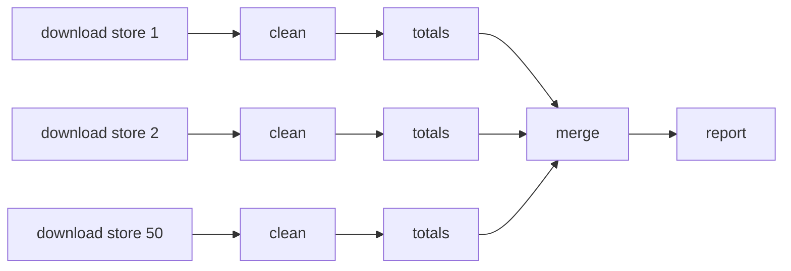
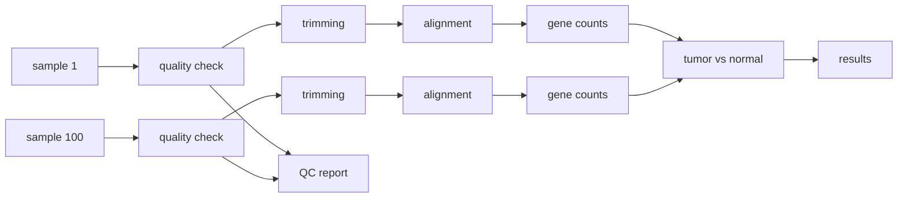
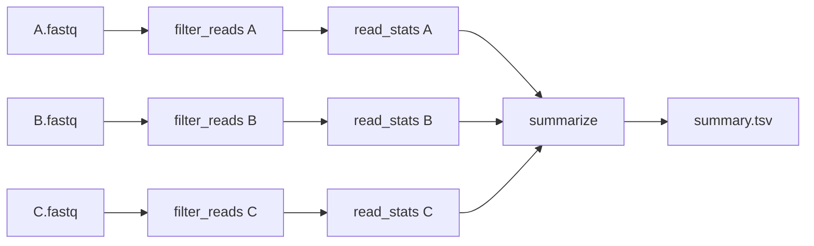

# Workflows for bioinformatics with Snakemake and Nextflow

A short tutorial for Python users from any field. It explains what workflows
are, why bioinformatics depends on them, and implements the same small
pipeline twice, once with Snakemake and once with Nextflow, on real DNA
sequencing data. No biology background is needed.

Disclaimer: this tutorial was prepared with the help of Claude.ai, an AI
assistant made by Anthropic. The code was tested with Python 3.13,
Snakemake 9.27 and Nextflow 25.04. Please report errors or unclear parts as a
GitHub issue.


## Setup

You need Python 3.10 or newer, Snakemake 8 or newer, and Nextflow 24 or newer.
Nextflow needs Java 17 or newer.

With GitHub Codespaces nothing has to be installed on your computer. On the
repository page click Code > Codespaces > Create codespace. The
`.devcontainer` folder installs all the tools.

With conda:

```bash
conda env create -f environment.yml
conda activate bio-workflows
```

With pip, and Nextflow installed separately:

```bash
python -m venv .venv
source .venv/bin/activate
pip install -r requirements.txt

curl -s https://get.nextflow.io | bash
mv nextflow ~/.local/bin/     # any folder on your PATH
```

Check the installation:

```bash
python -m pytest -q
snakemake --version
nextflow -version
```

On Windows, Nextflow runs only in WSL. WSL is also the easier option for
Snakemake.


## What is a workflow?

A workflow is a sequence of computational steps where the output of one step
is the input of the next. A workflow management system is the software that
runs the steps in the right order, keeps track of what is done, and reruns
what is needed when something changes.

### A common example

A company has 50 stores and wants a weekly sales report. The steps are:

1. download the sales file of each store
2. clean each file (fix dates, remove duplicate rows)
3. compute the totals of each store
4. merge the totals of all stores in one table
5. make the plots and write the report



A Python script with a `for` loop over the stores works the first time.
Problems start later:

- the download of store 37 fails, and the script starts again from store 1
- the cleaning rule changes, and it is not clear which totals are now out of date
- each store could be processed at the same time, but the loop runs one at a time
- a new store opens and the code has to be edited
- someone else has to run the report and does not know the order of the scripts

A workflow manager solves these problems because each step is described with
its inputs, its outputs and its command. From that description it can:

- find the order of the steps (a dependency graph, or DAG)
- skip the steps whose outputs are up to date
- continue a failed run from the step that failed
- run independent steps in parallel, on a laptop, a cluster or the cloud
- read the settings from a config file
- create a separate software environment for each step (conda, Docker, Apptainer)
- keep a record of what ran, with which inputs and settings

The idea is old: `make` has done this for compiling code since 1976. The
tools in this tutorial add support for many samples, clusters, containers and
cloud storage.


## Workflows in bioinformatics

### Biology background

DNA stores the instructions of a cell. It is a long sequence of 4 letters:
A, C, G and T. The human genome has about 3 billion letters. A gene is a
section of DNA with the instructions for one product of the cell. When a gene
is active, the cell makes copies of it as RNA. The amount of RNA of a gene
shows how active the gene is.

Sequencing machines read DNA or RNA, but not as one long sequence. They read
millions of short fragments, called reads, usually 100 to 300 letters long.
For each letter the machine also reports a quality score, how sure it is that
the letter is correct. A score of 20 means 1 error in 100 letters, a score of
30 means 1 error in 1000 letters.

Reads and quality scores are stored in text files in the FASTQ format. Each
read has 4 lines:

```
@SRR800764.1                      read name
CATCTTTGGAGTAACTATTATTTCGCC...    sequence
+                                 separator
;:8:DDDDH>F+AEHHGIGECHJGIEH...    quality, one character per letter
```

### A bioinformatics example

A common study is RNA sequencing (RNA-seq) to find the genes that are more or
less active in tumor tissue than in normal tissue. With 50 patients and 2
samples each, there are 100 samples. Each sample goes through the same steps:

1. quality check of the reads (FastQC, written in Java)
2. trimming of the low quality ends of the reads (fastp, C++)
3. alignment: finding where each read comes from in the human genome
   (STAR, C++)
4. counting the reads of each gene (featureCounts, C)

Then, using all samples together:

5. statistical comparison of tumor and normal samples (DESeq2, R)
6. one report with the quality of all samples (MultiQC, Python)



This is about 400 jobs, with tools in 5 languages. One sample can be 10 to
50 GB and one alignment can take an hour, so the work runs on a cluster or in
the cloud. The results are published, so other people must be able to run the
same analysis and get the same answer.

This is why bioinformatics has its own workflow tools, and why the community
shares tested pipelines. The example above is close to
[nf-core/rnaseq](https://nf-co.re/rnaseq), which anyone can run with one
command. Other shared pipelines are in [nf-core](https://nf-co.re) and in the
[Snakemake workflow catalog](https://snakemake.github.io/snakemake-workflow-catalog/).


## The example in this repository

The example is a small version of the first steps above: a quality check of
3 samples (A, B, C), 2,500 reads each.



1. `filter_reads` removes the reads with average quality below 20.
2. `read_stats` computes the number of reads, the mean length, the GC content
   and the mean quality of each sample. GC content is the percent of letters
   that are G or C. Each species has a typical value (human DNA is about 41%),
   so a sample with a very different value may be contaminated, mislabeled or
   from a failed run.
3. `summarize` merges the statistics of all samples in one table.

Each step is a Python script in [`scripts/`](scripts), using only the
standard library. The Snakemake and Nextflow workflows run the same scripts
with the same settings, so the only difference between them is the workflow
tool. Steps 1 and 2 run for each sample in parallel and step 3 waits for all
of them. This pattern (split by sample, then merge) is the most common one in
bioinformatics.

Run the workflows from the repository folder:

```bash
snakemake --snakefile snakemake/Snakefile --cores 2
nextflow run nextflow/main.nf
```

Both write `summary.tsv`, in `results/snakemake/` and `results/nextflow/`:

```
sample  reads  mean_length  gc_percent  mean_quality
A       2287   101.0        36.67       34.46
B       2106   101.0        36.06       33.63
C       686    101.9        49.83       20.8
```

Samples A and B are similar. Sample C lost most of its reads in the quality
filter and its GC content is different. In a real study, sample C would be
checked before any further analysis.

Samples A and B are real reads from the
[Snakemake tutorial data](https://github.com/snakemake/snakemake-tutorial-data).
Sample C is from a separate test file with lower quality, from the BIOINF 576
course materials, and was chosen to stand out.

How each tool implements the workflow, its main features, and exercises:

- [snakemake/README.md](snakemake/README.md)
- [nextflow/README.md](nextflow/README.md)


## Software to manage workflows

| Tool | Language | Pros | Cons |
|---|---|---|---|
| [Snakemake](https://snakemake.readthedocs.io) | Python based | Python code can be used in the workflow. Rules based on files, similar to Make. Dry runs. Conda environment or container for each rule. Runs on clusters and cloud with plugins. Large bioinformatics community. | Works backwards from the output files, which takes time to learn. Slow to plan very large workflows (hundreds of thousands of jobs). |
| [Nextflow](https://www.nextflow.io) | Groovy based | Data flows between steps through channels. Very good support for HPC and cloud. Easy to resume. nf-core has over 100 reviewed pipelines. | New language for Python users. Requires Java. Errors are in the `work` folder, with hashed folder names. |
| [CWL](https://www.commonwl.org) | YAML | Standard supported by several engines (cwltool, Toil, Arvados). Good for sharing and archiving workflows. | Verbose, hard to write by hand. Limited support for conditions and loops. |
| [WDL](https://openwdl.org) (Cromwell, miniwdl) | WDL | Easy to read. Used by the Broad Institute, GATK and Terra. | Smaller community outside genomics. Engines support different features. |
| [Galaxy](https://galaxyproject.org) | Web interface | No programming. Good for teaching and for users who do not code. Thousands of tools available. | Less flexible. Running your own server takes work. Hard to keep under version control. |
| [GNU Make](https://www.gnu.org/software/make/) | Makefile | Installed on most systems. Simple for small projects. | Hard to use with many samples and multiple outputs. No support for clusters, containers or environments. |
| [Airflow](https://airflow.apache.org), [Prefect](https://www.prefect.io), [Dagster](https://dagster.io) | Python | Scheduled data pipelines, dashboards, retries and alerts. Used in data engineering. | Designed for recurring jobs with databases and APIs, not for large files on a cluster. More setup for a single analysis. |

In short: Snakemake is the easiest start for Python users. Nextflow with
nf-core is the usual choice for ready-made pipelines and large scale cloud
runs. CWL and WDL are used to share workflows across platforms and
institutions. Galaxy is for users who do not code. Airflow, Prefect and
Dagster fit pipelines that run on a schedule on business data, like the
sales report example.


## Follow-up work

The example is small on purpose. Some ideas for experienced Python
programmers:

1. Make the FASTQ parser faster. Profile it, then try `numpy`, `polars`,
   `pysam`, or a Rust extension with PyO3 and maturin. Compare the versions
   with the Snakemake `benchmark:` directive.
2. Read compressed input files (`.fastq.gz`), the usual format of real data.
   Choose `gzip.open` or `open` from the file extension.
3. Add property-based tests with `hypothesis`: generate random reads, write
   them to a file, read them back and compare. Add tests for broken files.
4. Make the scripts a Python package (`pyproject.toml`, entry points such as
   `bioqc-filter`) and call the commands from the workflows.
5. Add a software environment for each step: the `conda:` and `container:`
   directives in Snakemake, `conda` or `container` in Nextflow processes.
6. Add an alignment step: align the reads to a reference genome with
   `bwa mem` and `samtools`, and report the percent of reads that align.
7. Support paired-end reads, where `sample_1.fastq` and `sample_2.fastq`
   belong together. Use `channel.fromFilePairs` in Nextflow and two input
   files in Snakemake.
8. Create an HTML report with a plot of the quality per position for each
   sample. See Snakemake `--report` and Nextflow `-with-report`.
9. Run the workflow on a cluster or in the cloud: the SLURM executor plugin
   for Snakemake, or a Nextflow profile for AWS Batch or Google Batch.
10. Implement the same pipeline with a Python tool (Prefect, Dagster, pytask)
    or write a small DAG runner with `asyncio`. Compare how each tool decides
    which steps to rerun.
11. Download public data with [nf-core/fetchngs](https://nf-co.re/fetchngs)
    and run the workflow on it.


## Repository content

```
data/samples/        FASTQ files for samples A, B, C
scripts/             Python scripts for each step
snakemake/           Snakefile, config.yaml and the Snakemake tutorial
nextflow/            main.nf, nextflow.config and the Nextflow tutorial
tests/               tests for the scripts (pytest)
.github/workflows/   runs the tests and both workflows on every push
.devcontainer/       setup for GitHub Codespaces
push_to_github.sh    creates a GitHub repository from this folder
```


## Resources

- Snakemake tutorial: https://snakemake.readthedocs.io/en/stable/tutorial/tutorial.html
- Nextflow training: https://training.nextflow.io
- nf-core pipelines: https://nf-co.re/pipelines
- Snakemake workflow catalog: https://snakemake.github.io/snakemake-workflow-catalog/
- Comparison of workflow tools (pytask): https://pytask-dev.readthedocs.io/en/stable/explanations/comparison_to_other_tools.html
- Cohen-Boulakia, S. et al., 2017. Scientific workflows for computational
  reproducibility in the life sciences: Status, challenges and opportunities.
  Future Generation Computer Systems, 75, pp.284-298.


## Credits

Based on the Workflows lecture of BIOINF 576, Bioinformatics Software
Development, University of Michigan. Samples A and B are from the Snakemake
tutorial data by Johannes Köster and contributors.
